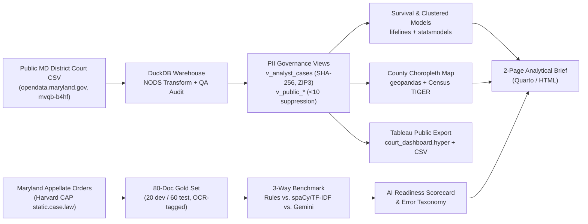

# Open Court Analytics

Reproducible Python and SQL pipeline for **state court case processing analytics**, **National Open Court Data Standards (NODS)** alignment with PII governance, **3-way unstructured court-order extraction benchmarking** (regex vs. classical NLP vs. schema-validated LLM), **survival and fixed-effects modeling**, and **public-safe Tableau reporting**—built entirely on real public Maryland state court records.

---

## Architecture



---

## Headline Results (100% Real Public Data)

### 1. Data Warehouse, NODS Alignment & PII Governance (`Phase 1`)
* **100,000** raw Maryland District Court eviction event rows ingested (Apr–Sep 2026) → **71,673** unique normalized cases across all **24 Maryland jurisdictions** (0 unmapped FIPS).
* Automated QA flagged and documented **19,716** left-truncated warrant returns (petition predated extract window), **9** impossible timelines (`disposition_date < filing_date`), and **7** messy clerk docket strings.
* **51,948** valid petition-cohort cases exposed via `v_analyst_cases` (salted SHA-256 `case_id_hash`, raw city/5-digit ZIP dropped); **38** county-category cells suppressed under `< 10` small-cell privacy thresholds.

### 2. Unstructured Court Order Extraction Benchmark (`Phase 2`, n = 60 Held-Out Orders)

| Method | Mean Precision | Mean Recall | Mean Macro-F1 | Exact Accuracy | Median Latency | Cost / 1k Docs | Unsupported Quotes |
| :--- | :---: | :---: | :---: | :---: | :---: | :---: | :---: |
| **Deterministic Rules (`regex`)** | **0.906** | 0.865 | **0.871** | 89.7% | **0.15 ms** | **\$0.00** | N/A |
| **Classical NLP (`spaCy` + `TF-IDF`)** | 0.515 | 0.544 | 0.499 | 68.9% | 80.9 ms | **\$0.00** | N/A |
| **Structured LLM (`gemini-3.8-flash`)** | 0.891 | **0.879** | 0.862 | **92.2%** | 6,968 ms | \$0.39 | **0.0%** |

* **Key operational finding:** A **hybrid pipeline** beats LLM-only deployment. Deterministic regex wins on structured docket IDs (`0.950 F1`, 0.15 ms) and standard appellate decretals (`1.000 F1`), while the LLM delivers a **+24.5 Macro-F1 gain** on nuanced remand/procedural detection (`0.983 vs. 0.738`) with **0.0% hallucinated quotes** (`docs/AI_EVALUATION_SCORECARD.md`).

### 3. Case Processing Survival Analysis, Regressions & Mapping (`Phase 3`)
* **Survivorship Bias:** With **53.0% (27,542)** of petitions still open at extract cutoff, naive closed-case medians report **46.0 days** vs. the Kaplan–Meier right-censored median of **65.0 days** (+19 days / 41% understatement).
* **County-Stratified Cox PH (`n = 51,948`):** `Wrongful Detainer` resolves faster (`HR = 1.16, 95% CI: 1.05–1.28`), while `Public Housing FTPR` resolves slower (`HR = 0.73, 95% CI: 0.60–0.89`).
* **County-Clustered Logit (`n = 51,500`):** Institutional batch e-filers have lower odds of executed eviction (`OR = 0.58, 95% CI: 0.52–0.65`), confirmed in a 60-day mature-cohort sensitivity check (`OR = 0.60, n = 31,451`).
* **Local Clerk Logging Audit:** Discovered that Baltimore City logs almost no `Cancelled` (61) or `Expired` (0) returns in this feed compared to neighboring counties—documented explicitly in `docs/LIMITATIONS_MEMO.md`.

---

## Executive Deliverables (`Phase 4`)
* **2-Page Analytical Brief:** `reports/court_data_brief.qmd` & `reports/court_data_brief.html`
* **Non-Technical Pre-Deployment AI Scorecard:** `docs/AI_EVALUATION_SCORECARD.md`
* **Methodological & Causal Limitations Memo:** `docs/LIMITATIONS_MEMO.md`
* **Tableau Public Extract & Specification:** `outputs/tableau/court_dashboard.hyper`, CSV fallbacks, and `outputs/tableau/dashboard_spec.md` *(Published Tableau Public link: add URL after publishing `.hyper` extract)*

> **Language & Reproducibility Note:** The entire pipeline is implemented in **Python + SQL** for one unified environment (`uv`). Equivalent R workflows map cleanly to `survival` (`survfit` / `coxph`), `fixest` (`feols` / `feglm` with county-clustered SEs), and `sf` + `ggplot2`.

---

## Reproducing the End-to-End Pipeline

```bash
# 1. Sync environment
uv sync
source .venv/bin/activate
cp .env.example .env   # add GEMINI_API_KEY for Phase 2 LLM extraction

# 2. Phase 1 — Fetch Maryland court + Census data & build NODS DuckDB warehouse
python src/db/00_fetch_court_data.py --limit 100000
python src/db/build_warehouse.py

# 3. Phase 2 — Fetch Maryland CAP orders & run 3-way extraction benchmark
python src/nlp/01_fetch_court_orders.py --max-docs 150
python src/nlp/02_extract_rules.py
python src/nlp/03_extract_classical_nlp.py
python src/nlp/04_extract_llm.py
python src/nlp/05_evaluate_benchmark.py

# 4. Phase 3 — Survival analysis, regressions, county map, and Tableau export
python src/analytics/01_time_to_disposition.py
python src/analytics/02_regression_models.py
python src/analytics/03_county_map.py
python src/analytics/04_export_tableau.py

# 5. Phase 4 — Render self-contained analytical brief (or `quarto render reports/court_data_brief.qmd`)
python reports/render_brief_html.py
```
