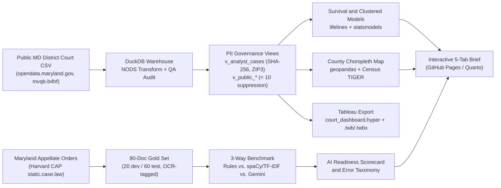
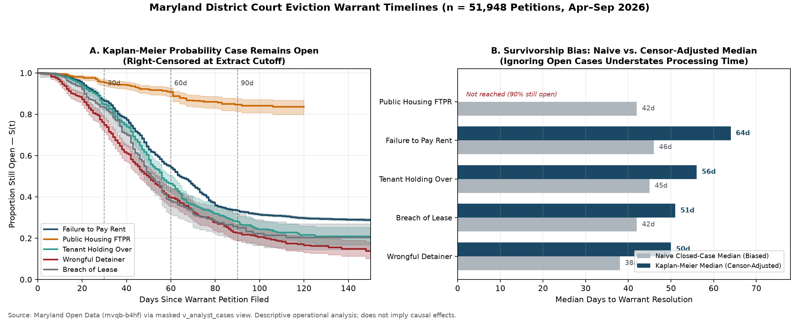

# Open Court Analytics

> **Live 5-Tab Interactive Dashboard:** [https://mhadeli.github.io/open-court-analytics/](https://mhadeli.github.io/open-court-analytics/)

## What This Project Is

This project uses real public **Maryland state court records** to answer two practical questions courts deal with every day:
1. *How long do housing and eviction cases actually take across counties, and what data traps distort those numbers?*
2. *Where can courts safely use AI (LLMs) to extract data from court orders—and where should they stick to simple rules or human review?*

### Summary of Results

1. **Cleaning & Protecting Court Data (SQL Warehouse):** Ingested **100,000** public Maryland District Court eviction event records (Apr–Sep 2026) across all **24 jurisdictions** into a NODS-aligned DuckDB warehouse. Removed **19,716** incomplete early records and **9** impossible dates, leaving **51,948 valid petitions**. All downstream analysis uses masked SQL views (hashed IDs, stripped addresses/full ZIPs) with automatic **`< 10` small-cell suppression** (hiding Garrett County's median and 38 small county-category cells).
2. **Case Timelines & Outcomes (Statistics & Mapping):** Because **53% (27,542)** of petitions are still open at cutoff, averaging closed cases alone makes processing look like **46 days**, while survival analysis (Kaplan–Meier) puts the true median at **65 days** (+41% bias). Only **8.7%** (**4,526**) ended in an executed eviction. Rural counties close warrants far faster (Allegany 12d, Cecil 15d) than urban dockets (Anne Arundel 55d, Baltimore City 54d, Prince George's 53d)—though auditing raw events revealed that **Baltimore City logs almost no `Cancelled` (61) or `Expired` (0) returns**, so raw clearance comparisons require local clerk context.
3. **Testing AI on Real Court Orders (Rules vs. Classical NLP vs. LLM):** Benchmarked all three methods on **60 held-out Maryland appellate orders** across 6 fields. **A hybrid pipeline wins:** simple regex matched the LLM overall (`0.871` vs. `0.862` F1) at `0.15 ms/doc` and `$0` for structured docket IDs and standard rulings, while `gemini-3.8-flash` added **+24.5 Macro-F1** on nuanced remand/stay detection (`0.983` vs. `0.738`) with **0.0% hallucinated quotes** (via forced `UNKNOWN` abstention + verbatim quote checks). Translated into a **Green / Yellow / Red** [AI Readiness Scorecard](docs/AI_EVALUATION_SCORECARD.md) (*Green*: docket IDs & standard rulings; *Yellow*: remands, categories & pro se flags with review; *Red*: never auto-post dollar judgments).
4. **Outputs:** A live [5-Tab Interactive Web Dashboard](https://mhadeli.github.io/open-court-analytics/), a [Tableau Desktop Workbook](outputs/tableau/court-analytics.twb) (video walkthrough below), a [2-Page Quarto Brief](reports/court_data_brief.qmd), and a [Limitations Memo](docs/LIMITATIONS_MEMO.md).

---

## Architecture



---

## Visuals & Model Results

### Court Order Extraction Benchmark (n = 60 Held-Out Maryland Orders)

| Method | Mean Precision | Mean Recall | Mean Macro-F1 | Exact Accuracy | Median Latency | Cost / 1k Docs | Unsupported Quotes |
| :--- | :---: | :---: | :---: | :---: | :---: | :---: | :---: |
| **Deterministic Rules (`regex`)** | **0.906** | 0.865 | **0.871** | 89.7% | **0.15 ms** | **$0.00** | N/A |
| **Classical NLP (`spaCy` + `TF-IDF`)** | 0.515 | 0.544 | 0.499 | 68.9% | 80.9 ms | **$0.00** | N/A |
| **Structured LLM (`gemini-3.8-flash`)** | 0.891 | **0.879** | 0.862 | **92.2%** | 6,968 ms | $0.39 | **0.0%** |

Details: [per-field metrics](outputs/benchmark_metrics.csv) · [concrete failure cases](outputs/error_taxonomy.md) · [Green/Yellow/Red AI scorecard](docs/AI_EVALUATION_SCORECARD.md)

### Case Processing Timelines, Regressions & County Map



* **Resolution Benchmarks:** Kaplan–Meier cumulative resolution is **13.6% within 30 days**, **45.6% within 60 days**, and **66.2% within 90 days** ([time_to_disposition_summary.csv](outputs/time_to_disposition_summary.csv)).
* **County-Stratified Cox PH (`n = 51,948`):** `Wrongful Detainer` resolves faster (`HR = 1.16, 95% CI: 1.05–1.28`), while `Public Housing FTPR` resolves slower (`HR = 0.73, 95% CI: 0.60–0.89`).
* **County-Clustered Logit (`n = 51,500`):** Institutional batch e-filers have **42% lower odds** of executed eviction (`OR = 0.58, 95% CI: 0.52–0.65`), confirmed in a 60-day mature-cohort check (`OR = 0.60, n = 31,451`) ([model_coefficients.csv](outputs/model_coefficients.csv)).


### Tableau Desktop Dashboard Walkthrough

Built in **Tableau Desktop** on the suppressed Hyper extract ([court_dashboard.hyper](outputs/tableau/court_dashboard.hyper), [dashboard_spec.md](outputs/tableau/dashboard_spec.md)) with statewide KPIs, a 24-jurisdiction Maryland map, monthly trends, and 60-day compliance by county.

https://github.com/user-attachments/assets/74a69422-5512-4777-ac43-434451c8d5cb

---

## Project Structure

```text
open-court-analytics/
├── README.md                                   # Project overview, findings, visuals, and run instructions
├── pyproject.toml                              # Python 3.12 dependencies and project configuration (uv)
├── uv.lock                                     # Locked cross-platform dependency versions
├── .env.example                                # Template for GEMINI_API_KEY (.env is gitignored)
│
├── sql/                                        # Phase 1: NODS data warehouse & privacy governance SQL
│   ├── 01_staging_load.sql                     # Load raw MD eviction CSV & normalize clerk case numbers
│   ├── 02_nods_transform.sql                   # Map 24 MD FIPS codes into NODS cases, events, and parties
│   ├── 03_pii_governance_views.sql             # Masked v_analyst_cases (SHA-256, ZIP3) & <10 suppressed views
│   └── 04_data_quality_audit.sql               # Automated QA counts (truncation, bad dates, censoring)
│
├── src/
│   ├── db/
│   │   ├── 00_fetch_court_data.py              # Download MD District Court CSV (mvqb-b4hf) & Census shapefile
│   │   └── build_warehouse.py                  # Run SQL 01–04 in DuckDB & enforce PII / suppression assertions
│   ├── nlp/                                    # Phase 2: 3-way court-order extraction benchmark
│   │   ├── 01_fetch_court_orders.py            # Fetch MD appellate orders from Harvard CAP & build dev/test splits
│   │   ├── 02_extract_rules.py                 # Baseline 1: deterministic regex & keyword extractor
│   │   ├── 03_extract_classical_nlp.py         # Baseline 2: spaCy NER/Matcher + TF-IDF linear models
│   │   ├── 04_extract_llm.py                   # Baseline 3: schema-validated Gemini (UNKNOWN + verbatim quotes)
│   │   └── 05_evaluate_benchmark.py            # Score precision/recall/F1, hallucination, OCR drop, latency, cost
│   └── analytics/                              # Phase 3: Survival analysis, regressions, mapping & Tableau
│       ├── 01_time_to_disposition.py           # Kaplan–Meier curves (lifelines) & survivorship-bias audit
│       ├── 02_regression_models.py             # County-stratified Cox PH, clustered logit & 60d sensitivity check
│       ├── 03_county_map.py                    # 24-county Maryland choropleth map (geopandas + Census TIGER)
│       ├── 04_export_tableau.py                # Export suppressed public aggregates to .hyper + CSVs + spec
│       └── 05_build_tableau_workbook.py        # Programmatic starter .twbx workbook generator
│
├── data/
│   ├── raw/                                    # Downloaded raw CSVs, shapefiles & CAP JSONL (gitignored)
│   ├── processed/                              # Local DuckDB warehouse court_warehouse.duckdb (gitignored)
│   └── gold/
│       ├── annotation_guidelines.md            # Field definitions, UNKNOWN rules & OCR quality tagging rubric
│       └── gold_court_orders.jsonl             # Audited 80-doc gold dataset (20 dev / 60 test)
│
├── outputs/
│   ├── qa_audit_summary.csv                    # Phase 1 warehouse QA and small-cell suppression summary
│   ├── preds_*.jsonl                           # Per-document test predictions (rules, classical_nlp, llm_gemini)
│   ├── benchmark_metrics.csv                   # Per-field accuracy, F1, OCR drop, latency & cost metrics
│   ├── error_taxonomy.md                       # Concrete held-out failure cases across all 3 extractors
│   ├── time_to_disposition_summary.csv         # Naive vs. Kaplan–Meier medians & 30/60/90/120d benchmarks
│   ├── km_curves.png                           # Survival curves & survivorship-bias comparison plot
│   ├── model_coefficients.csv                  # Cox PH & county-clustered logit estimates with 95% CIs
│   ├── county_bottlenecks_map.png              # Maryland median-days and eviction-rate choropleth map
│   └── tableau/
│       ├── court-analytics.twb                 # Tableau Desktop interactive dashboard workbook
│       ├── court_dashboard.twbx                # Packaged Tableau starter workbook
│       ├── court_dashboard.hyper               # Suppressed Tableau Hyper extract (zero PII / case rows)
│       ├── court_dashboard_*.csv               # CSV fallbacks (county_overall, county_category, monthly)
│       └── dashboard_spec.md                   # KPIs, layout, filters, and privacy caption specification
│
├── reports/
│   ├── court_data_brief.qmd                    # Phase 4: 2-page Quarto executive brief source
│   ├── court_data_brief.html                   # Interactive 5-tab HTML dashboard & brief (standalone)
│   └── render_brief_html.py                    # Generates interactive HTML for reports/ and docs/index.html
│
└── docs/
    ├── index.html                              # GitHub Pages entry point for the 5-tab interactive dashboard
    ├── AI_EVALUATION_SCORECARD.md              # 1-page non-technical Green/Yellow/Red AI deployment scorecard
    └── LIMITATIONS_MEMO.md                     # Clerk logging gaps, censoring, OCR, and causal guardrails
```

---

## Public Data Sources & Reproducibility

* **Structured Court Records:** [District Court of Maryland Eviction Case Data (`mvqb-b4hf`)](https://opendata.maryland.gov/Housing/District-Court-of-Maryland-Eviction-Case-Data/mvqb-b4hf) — Maryland Open Data Portal (no key required).
* **Unstructured Court Decisions:** [Harvard Caselaw Access Project (`static.case.law/md-app/`)](https://case.law/) — Court of Special Appeals of Maryland (volumes 201–206).
* **Geographic Boundaries:** [U.S. Census Bureau 2023 Cartographic Boundary Files](https://www2.census.gov/geo/tiger/GENZ2023/shp/cb_2023_us_county_20m.zip) (`STATEFP = 24`).

> **Stack note:** Implemented in **Python + SQL** (`uv`) for one consistent environment. Equivalent R workflows map directly to `survival`, `fixest`, and `sf`.

```bash
# 1. Sync environment
uv sync
source .venv/bin/activate
cp .env.example .env   # add GEMINI_API_KEY for Phase 2 LLM extraction

# 2. Phase 1 — Fetch Maryland court + Census data & build NODS DuckDB warehouse
python src/db/00_fetch_court_data.py --limit 100000
python src/db/build_warehouse.py

# 3. Phase 2 — Fetch Maryland CAP orders & run 3-way extraction benchmark
python src/nlp/01_fetch_court_orders.py --max-docs 150
python src/nlp/02_extract_rules.py
python src/nlp/03_extract_classical_nlp.py
python src/nlp/04_extract_llm.py
python src/nlp/05_evaluate_benchmark.py

# 4. Phase 3 — Survival analysis, regressions, county map & Tableau exports
python src/analytics/01_time_to_disposition.py
python src/analytics/02_regression_models.py
python src/analytics/03_county_map.py
python src/analytics/04_export_tableau.py
python src/analytics/05_build_tableau_workbook.py

# 5. Phase 4 — Render 5-tab interactive HTML dashboard (reports/ and docs/index.html)
python reports/render_brief_html.py
```

---

## Scope Disclaimer & License

All results in this repository are **descriptive operational analyses** of public administrative records and should not be interpreted as causal evidence of judicial, clerk, or landlord behavior. See [docs/LIMITATIONS_MEMO.md](docs/LIMITATIONS_MEMO.md) for full caveats. Released under the MIT License.
