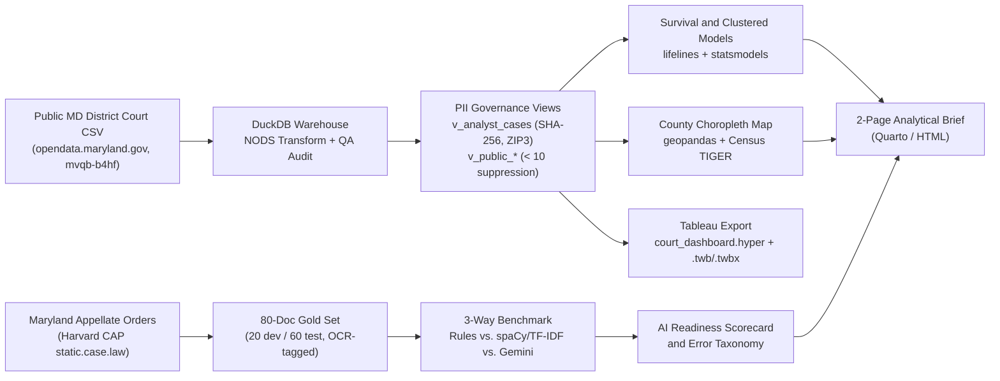
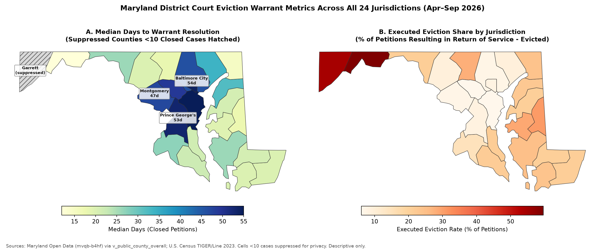

# Open Court Analytics

Reproducible Python and SQL pipeline for **state court case processing analytics**, **National Open Court Data Standards (NODS)** alignment with PII governance, **3-way unstructured court-order extraction benchmarking** (regex vs. classical NLP vs. schema-validated LLM), **survival and fixed-effects statistical modeling**, and **public-safe Tableau reporting**—built entirely on real public Maryland state court records.

### Key Takeaways at a Glance
* **41% Survivorship Bias in Naive Case Timelines:** Across **51,948** Maryland District Court eviction warrant petitions (Apr–Sep 2026), **53.0% (27,542)** remain open at cutoff. Ignoring open cases yields a naive median of **46.0 days** vs. the Kaplan–Meier right-censored median of **65.0 days** (+19 days).
* **Hybrid Rule + LLM Pipelines Beat LLM-Only Deployment:** On **60 held-out Maryland appellate orders**, deterministic rules match or beat the LLM on structured docket IDs (`0.950 F1`, `0.15 ms`, `$0.00`) and standard decretals (`1.000 F1`), while `gemini-3.8-flash` delivers a **+24.5 Macro-F1 lift** on nuanced remand/procedural detection (`0.983` vs. `0.738`) with **0.0% unsupported citations**.
* **Local Clerk Logging Drives Apparent Clearance Gaps:** Auditing event types across all 24 Maryland jurisdictions revealed that Baltimore City logs almost no `Cancelled` (61) or `Expired` (0) warrant returns in the public feed compared to neighboring counties—underscoring why raw cross-county clearance rates require schema audits before policy interpretation.

---

## Architecture



---

## Headline Results (100% Real Public Data)

### 1. Data Warehouse, NODS Alignment & PII Governance (`Phase 1`)
* **100,000** raw Maryland District Court eviction event rows ingested (Apr–Sep 2026) → **71,673** unique normalized cases across all **24 Maryland jurisdictions** (`0` unmapped county FIPS).
* Automated QA ([outputs/qa_audit_summary.csv](outputs/qa_audit_summary.csv)) flagged and documented **19,716** left-truncated warrant returns (initial petition predated the extract window), **9** impossible timelines (`disposition_date < filing_date`), and **7** messy clerk docket strings.
* **51,948** valid petition-cohort cases exposed via `v_analyst_cases` (salted SHA-256 `case_id_hash`, raw city and 5-digit ZIP removed, coarsened to 3-digit `tenant_zip3`); **38** county-category cells and Garrett County's closed-case median automatically suppressed under `< 10` privacy thresholds.

### 2. Unstructured Court Order Extraction Benchmark (`Phase 2`, n = 60 Held-Out Orders)

| Method | Mean Precision | Mean Recall | Mean Macro-F1 | Exact Accuracy | Median Latency | Cost / 1k Docs | Unsupported Quotes |
| :--- | :---: | :---: | :---: | :---: | :---: | :---: | :---: |
| **Deterministic Rules (`regex`)** | **0.906** | 0.865 | **0.871** | 89.7% | **0.15 ms** | **$0.00** | N/A |
| **Classical NLP (`spaCy` + `TF-IDF`)** | 0.515 | 0.544 | 0.499 | 68.9% | 80.9 ms | **$0.00** | N/A |
| **Structured LLM (`gemini-3.8-flash`)** | 0.891 | **0.879** | 0.862 | **92.2%** | 6,968 ms | $0.39 | **0.0%** |

* Full per-field precision/recall/OCR-drop metrics: [outputs/benchmark_metrics.csv](outputs/benchmark_metrics.csv)
* Concrete failure cases across all three methods: [outputs/error_taxonomy.md](outputs/error_taxonomy.md)
* Non-technical Green/Yellow/Red deployment guidance: [docs/AI_EVALUATION_SCORECARD.md](docs/AI_EVALUATION_SCORECARD.md)

### 3. Case Processing Survival Analysis, Regressions & County Mapping (`Phase 3`)


* **Time-to-Disposition Benchmarks:** Kaplan–Meier cumulative resolution across all 51,948 petitions is **13.6% within 30 days**, **45.6% within 60 days**, and **66.2% within 90 days** ([outputs/time_to_disposition_summary.csv](outputs/time_to_disposition_summary.csv)).
* **County-Stratified Cox PH (`n = 51,948`):** `Wrongful Detainer` petitions resolve faster (`HR = 1.16, 95% CI: 1.05–1.28`), while `Public Housing FTPR` resolves slower (`HR = 0.73, 95% CI: 0.60–0.89`).
* **County-Clustered Logit (`n = 51,500`):** Institutional batch e-filers show lower odds of executed eviction (`OR = 0.58, 95% CI: 0.52–0.65`), confirmed in a 60-day mature-cohort sensitivity check (`OR = 0.60, n = 31,451`) ([outputs/model_coefficients.csv](outputs/model_coefficients.csv)).



---

## Executive Deliverables

* **2-Page Analytical Brief:** [reports/court_data_brief.qmd](reports/court_data_brief.qmd) | Rendered self-contained HTML: [reports/court_data_brief.html](reports/court_data_brief.html)
* **Pre-Deployment AI Readiness Scorecard:** [docs/AI_EVALUATION_SCORECARD.md](docs/AI_EVALUATION_SCORECARD.md)
* **Methodological & Causal Limitations Memo:** [docs/LIMITATIONS_MEMO.md](docs/LIMITATIONS_MEMO.md)
* **Tableau Dashboard Assets:** [outputs/tableau/court-analytics.twb](outputs/tableau/court-analytics.twb), [outputs/tableau/court_dashboard.twbx](outputs/tableau/court_dashboard.twbx), [outputs/tableau/court_dashboard.hyper](outputs/tableau/court_dashboard.hyper), suppressed CSV fallbacks, and [outputs/tableau/dashboard_spec.md](outputs/tableau/dashboard_spec.md) ([Tableau Public Profile](https://public.tableau.com/app/profile/adeli))

---

## Project Files & What They Do

### Phase 1 — Data Acquisition, NODS Warehouse & PII Governance
| File | Purpose |
| :--- | :--- |
| [src/db/00_fetch_court_data.py](src/db/00_fetch_court_data.py) | Downloads 100k public Maryland District Court eviction records (`mvqb-b4hf`) and U.S. Census TIGER county boundaries. |
| [sql/01_staging_load.sql](sql/01_staging_load.sql) | Ingests raw CSV rows into DuckDB and normalizes clerk whitespace inconsistencies in `casenumber`. |
| [sql/02_nods_transform.sql](sql/02_nods_transform.sql) | Maps all 24 jurisdictions to official 5-digit FIPS and builds NODS-aligned `nods_cases`, `nods_events`, and `nods_parties` tables. |
| [sql/03_pii_governance_views.sql](sql/03_pii_governance_views.sql) | Creates masked `v_analyst_cases` (SHA-256 IDs, ZIP3 coarsening) and `< 10` suppressed public views (`v_public_*`). |
| [sql/04_data_quality_audit.sql](sql/04_data_quality_audit.sql) | Logs automated counts for left-truncation, impossible timelines, unmapped FIPS, right-censoring, and suppressed cells. |
| [src/db/build_warehouse.py](src/db/build_warehouse.py) | Orchestrates SQL scripts 01–04, asserts PII and small-cell suppression invariants, and exports [outputs/qa_audit_summary.csv](outputs/qa_audit_summary.csv). |

### Phase 2 — Unstructured Court Order Extraction Benchmark
| File | Purpose |
| :--- | :--- |
| [data/gold/annotation_guidelines.md](data/gold/annotation_guidelines.md) | Defines the 6 extraction fields, `UNKNOWN` abstention rules, `evidence_span` verification, and `clean` vs. `noisy_ocr` criteria. |
| [data/gold/gold_court_orders.jsonl](data/gold/gold_court_orders.jsonl) | Audited 80-document gold evaluation set (`20 dev` / `60 test`) built from real Maryland appellate court opinions. |
| [src/nlp/01_fetch_court_orders.py](src/nlp/01_fetch_court_orders.py) | Fetches Maryland appellate opinions from Harvard CAP (`static.case.law/md-app/`), anchors closing decretals, and creates stratified splits. |
| [src/nlp/02_extract_rules.py](src/nlp/02_extract_rules.py) | Baseline 1: deterministic regex and keyword extractor on raw text → [outputs/preds_rules.jsonl](outputs/preds_rules.jsonl). |
| [src/nlp/03_extract_classical_nlp.py](src/nlp/03_extract_classical_nlp.py) | Baseline 2: `spaCy` NER/Matcher + `scikit-learn` TF-IDF classifiers fit strictly on `dev` → [outputs/preds_classical_nlp.jsonl](outputs/preds_classical_nlp.jsonl). |
| [src/nlp/04_extract_llm.py](src/nlp/04_extract_llm.py) | Baseline 3: Pydantic schema-validated Gemini extraction (`temperature=0`, `UNKNOWN` abstention, verbatim quotes) → [outputs/preds_llm.jsonl](outputs/preds_llm.jsonl). |
| [src/nlp/05_evaluate_benchmark.py](src/nlp/05_evaluate_benchmark.py) | Scores all 3 methods on the 60-doc test set and generates [outputs/benchmark_metrics.csv](outputs/benchmark_metrics.csv) and [outputs/error_taxonomy.md](outputs/error_taxonomy.md). |

### Phase 3 — Statistical Analysis, Mapping & Tableau Export
| File | Purpose |
| :--- | :--- |
| [src/analytics/01_time_to_disposition.py](src/analytics/01_time_to_disposition.py) | Contrasts naive closed-case medians against right-censored Kaplan–Meier survival curves (`lifelines`) → [outputs/km_curves.png](outputs/km_curves.png). |
| [src/analytics/02_regression_models.py](src/analytics/02_regression_models.py) | Fits county-stratified Cox PH, county-clustered fixed-effects logit (`statsmodels`), and a 60-day mature-cohort check → [outputs/model_coefficients.csv](outputs/model_coefficients.csv). |
| [src/analytics/03_county_map.py](src/analytics/03_county_map.py) | Joins suppressed county aggregates to Census TIGER shapefiles (`geopandas`) → [outputs/county_bottlenecks_map.png](outputs/county_bottlenecks_map.png). |
| [src/analytics/04_export_tableau.py](src/analytics/04_export_tableau.py) | Verifies zero PII / zero unsuppressed `< 10` cells and exports `court_dashboard.hyper`, CSV fallbacks, and [outputs/tableau/dashboard_spec.md](outputs/tableau/dashboard_spec.md). |
| [src/analytics/05_build_tableau_workbook.py](src/analytics/05_build_tableau_workbook.py) | Programmatically packages the suppressed CSVs into a starter Tableau workbook ([outputs/tableau/court_dashboard.twbx](outputs/tableau/court_dashboard.twbx)). |

### Phase 4 — Reporting, Documentation & Configuration
| File | Purpose |
| :--- | :--- |
| [reports/court_data_brief.qmd](reports/court_data_brief.qmd) | 2-page Quarto executive brief combining survival analysis, county maps, benchmark results, and causal guardrails. |
| [reports/render_brief_html.py](reports/render_brief_html.py) | Renders the self-contained HTML brief ([reports/court_data_brief.html](reports/court_data_brief.html)) with embedded charts (usable without Quarto CLI). |
| [docs/AI_EVALUATION_SCORECARD.md](docs/AI_EVALUATION_SCORECARD.md) | 1-page non-technical Green/Yellow/Red pre-deployment AI scorecard and operational safeguards checklist. |
| [docs/LIMITATIONS_MEMO.md](docs/LIMITATIONS_MEMO.md) | Documents cross-county clerk logging gaps, censoring/truncation caveats, OCR degradation, and causal limits. |
| [pyproject.toml](pyproject.toml) & [uv.lock](uv.lock) | Pinned Python 3.12 environment and locked dependency graph managed via `uv`. |
| [.env.example](.env.example) | Template environment file for configuring `GEMINI_API_KEY` locally (`.env` is gitignored). |

---

## Public Data Sources & Attribution

1. **Structured Court Records:** [District Court of Maryland Eviction Case Data (`mvqb-b4hf`)](https://opendata.maryland.gov/Housing/District-Court-of-Maryland-Eviction-Case-Data/mvqb-b4hf) — Maryland Open Data Portal (Socrata SODA API; no key required).
2. **Unstructured Court Decisions:** [Harvard Caselaw Access Project (`static.case.law/md-app/`)](https://case.law/) — Court of Special Appeals of Maryland published opinions (volumes 201–206).
3. **Geographic Boundaries:** [U.S. Census Bureau 2023 Cartographic Boundary Files](https://www2.census.gov/geo/tiger/GENZ2023/shp/cb_2023_us_county_20m.zip) — County polygons (`STATEFP = 24`).

---

## Reproducing the End-to-End Pipeline

> **Language & Reproducibility Note:** The pipeline is implemented in **Python + SQL** (`uv`) for one consistent environment. Equivalent R workflows map directly to `survival` (`survfit` / `coxph`), `fixest` (`feols` / `feglm` with county-clustered SEs), and `sf` + `ggplot2`.

```bash
# 1. Sync environment
uv sync
source .venv/bin/activate
cp .env.example .env   # add GEMINI_API_KEY for Phase 2 LLM extraction

# 2. Phase 1 — Fetch Maryland court + Census data & build NODS DuckDB warehouse
python src/db/00_fetch_court_data.py --limit 100000
python src/db/build_warehouse.py

# 3. Phase 2 — Fetch Maryland CAP orders & run 3-way extraction benchmark
python src/nlp/01_fetch_court_orders.py --max-docs 150
python src/nlp/02_extract_rules.py
python src/nlp/03_extract_classical_nlp.py
python src/nlp/04_extract_llm.py
python src/nlp/05_evaluate_benchmark.py

# 4. Phase 3 — Survival analysis, regressions, county map & Tableau exports
python src/analytics/01_time_to_disposition.py
python src/analytics/02_regression_models.py
python src/analytics/03_county_map.py
python src/analytics/04_export_tableau.py
python src/analytics/05_build_tableau_workbook.py

# 5. Phase 4 — Render self-contained analytical brief (or `quarto render reports/court_data_brief.qmd`)
python reports/render_brief_html.py
```

---

## Scope Disclaimer & License

All statistical results in this repository are **descriptive operational analyses** of public administrative records and should not be interpreted as causal evidence of judicial, clerk, or landlord behavior. See [docs/LIMITATIONS_MEMO.md](docs/LIMITATIONS_MEMO.md) for full caveats. Released under the MIT License.
