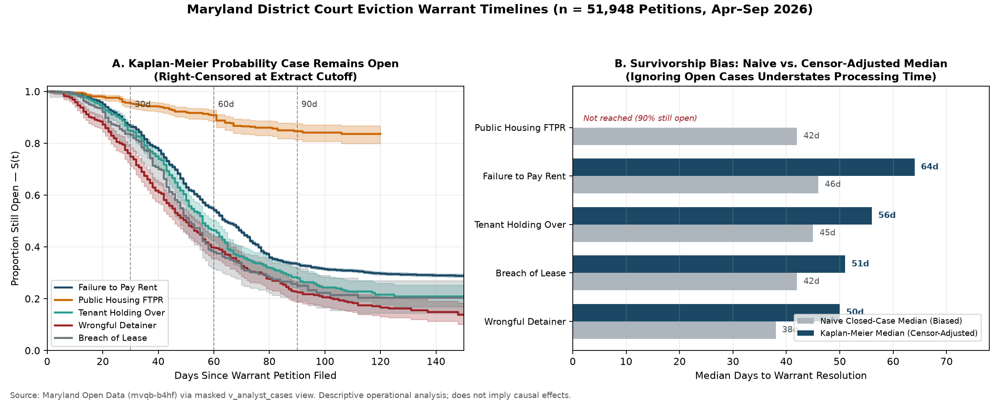
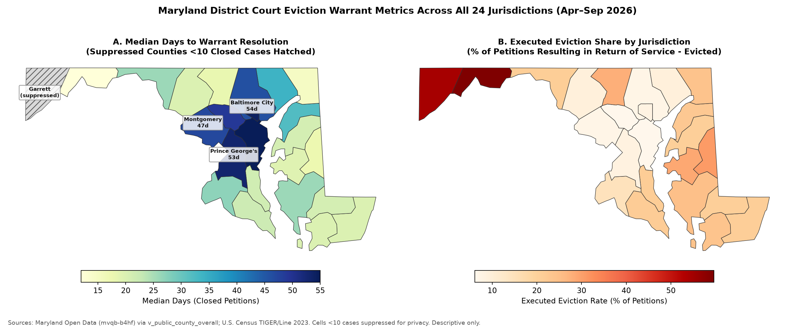

## Executive Summary

Using **100,000 public Maryland District Court eviction event records** (Apr–Sep 2026, covering **51,948 valid warrant petitions** across all 24 Maryland jurisdictions) and **80 real Maryland state court opinions**, this brief highlights three operational takeaways for court leaders:

1. **Ignoring open cases understates case processing time by 41%.** Naive closed-case averages report a **46.0-day** median from warrant petition to resolution, whereas Kaplan–Meier survival analysis accounting for the **27,542 still-open (right-censored) petitions (53.0%)** places the true median at **65.0 days** (+19 days).
2. **Cross-county metrics reflect both operational pace and local clerk logging differences.** Closed petitions resolve fastest in rural jurisdictions (e.g., Allegany 12d, Cecil 15d) and slowest in high-volume urban dockets (Anne Arundel 55d, Baltimore City 54d, Prince George's 53d). However, Baltimore City logs almost no `Cancelled` (61) or `Expired` (0) returns in the public feed—meaning raw county clearance rates cannot be compared without accounting for local CMS practices.
3. **Hybrid rule + LLM extraction outperforms "LLM-only" pipelines.** On 60 held-out Maryland court orders, deterministic regex matched or beat the LLM on structured identifiers and standard decretals at **\$0.00 cost and 0.15 ms/doc**, while `gemini-3.8-flash` added decisive value on nuanced remand/procedural detection (**0.983 vs. 0.738 Macro-F1**) with **0.0% unsupported citations**.

---

## 1. Case Processing Timelines & Survivorship Bias

* Across all 51,948 petitions in the masked `v_analyst_cases` cohort, Kaplan–Meier estimates show **13.6% resolved within 30 days**, **45.6% within 60 days**, and **66.2% within 90 days**.
* In county-stratified Cox proportional hazards models, **Wrongful Detainer** petitions resolve ~16% faster than standard Failure to Pay Rent (`HR = 1.16, 95% CI: 1.05–1.28`), while **Public Housing FTPR** resolves significantly slower (`HR = 0.73, 95% CI: 0.60–0.89`).
* In county-clustered fixed-effects logistic models (`n = 51,500`), petitions filed by institutional batch e-filers show **42% lower odds of resulting in an executed eviction** (`OR = 0.58, 95% CI: 0.52–0.65`), a finding confirmed in a 60-day mature-cohort sensitivity check (`OR = 0.60, n = 31,451`)—consistent with high-volume landlords filing petitions that are later redeemed or cancelled.

---

## 2. Geographic Variation Across Maryland Jurisdictions

* **Privacy Governance:** All public county and monthly aggregates enforce **small-cell suppression (`< 10` cases)**. Garrett County (`n_closed = 7`) is automatically suppressed on closed-case duration metrics, alongside 38 county-by-category cells statewide.
* **Interactive Dashboard:** Suppressed public aggregates are exported to `outputs/tableau/court_dashboard.hyper` (and CSV fallbacks) for Tableau Public following `outputs/tableau/dashboard_spec.md`.

---

## 3. Responsible LLM Document Extraction Benchmark (n = 60 Held-Out Orders)

| Method | Mean Precision | Mean Recall | Mean Macro-F1 | Exact Accuracy | Median Latency | Cost / 1k Docs |
| :--- | :---: | :---: | :---: | :---: | :---: | :---: |
| **Deterministic Rules (`regex`)** | **0.906** | 0.865 | **0.871** | 89.7% | **0.15 ms** | **\$0.00** |
| **Classical NLP (`spaCy` + `TF-IDF`)** | 0.515 | 0.544 | 0.499 | 68.9% | 80.9 ms | **\$0.00** |
| **Structured LLM (`gemini-3.8-flash`)** | 0.891 | **0.879** | 0.862 | **92.2%** | 6,968 ms | \$0.39 |

*See `docs/AI_EVALUATION_SCORECARD.md` for the non-technical Green/Yellow/Red deployment matrix and operational safeguards checklist.*

---

::: {.callout-warning}
## What This Data Can and Cannot Support

* **Can support:** Quantifying survivorship bias in time-to-disposition reporting, identifying cross-county operational bottlenecks and clerk event-logging gaps, and selecting field-level rule vs. LLM extraction strategies prior to deployment.
* **Cannot support:** Causal claims about judicial bias, landlord intent, or tenant legal outcomes. The public Maryland extract omits tenant legal representation, rent arrears, informal payment plans, and non-eviction warrant cancellations in Baltimore City (`docs/LIMITATIONS_MEMO.md`).
:::
